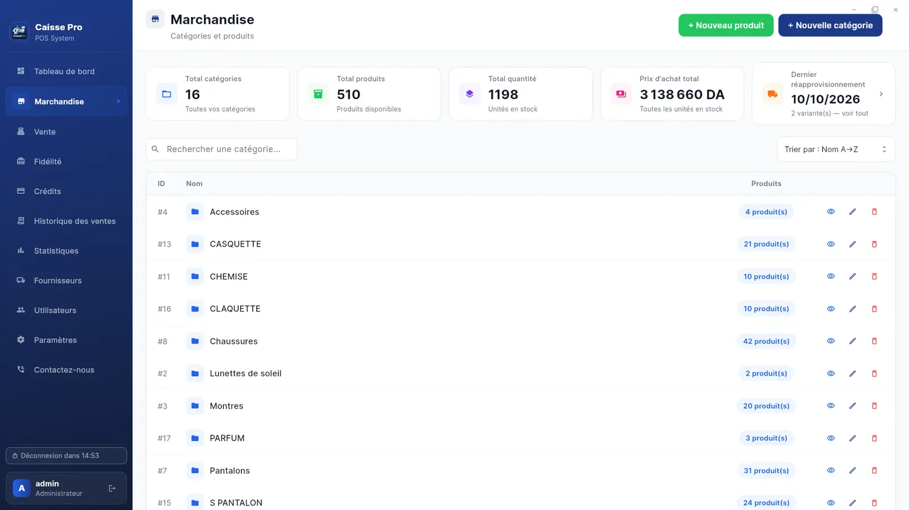
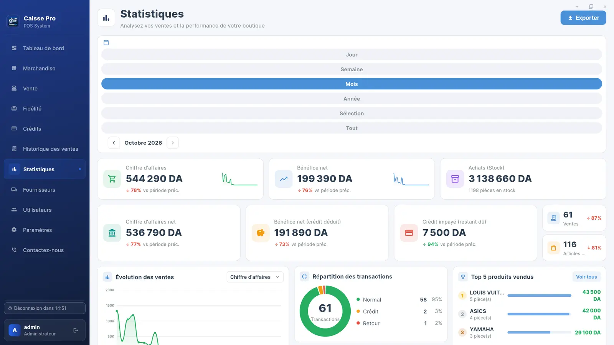

<p align="center">
  
</p>

<h1 align="center">CaissePro</h1>

<p align="center">
  <strong>Logiciel de caisse pour boutiques de vêtements · Algérie</strong><br>
  Caisse, stock par taille et couleur, crédits clients et statistiques dans un seul logiciel.<br>
  100 % hors ligne · Français &amp; العربية · Windows &amp; Linux
</p>

<p align="center">
  <a href="https://www.dinemohammedassam.com/project/caissepro/download"><strong>⬇️ Télécharger CaissePro (essai gratuit 7 jours)</strong></a>
</p>

---

## Présentation

CaissePro remplace le cahier, la calculatrice et les comptes de tête :

- **Le cahier de crédit** → chaque crédit noté, chaque versement suivi. Vous savez à tout moment quel client vous doit combien, et depuis quand.
- **L'inventaire à la main** → le stock se met à jour tout seul. Chaque vente retire la bonne taille et la bonne couleur, et une alerte vous prévient avant la rupture.
- **La caisse qui ne tombe pas juste** → un rapport clair à la fermeture : ventes, retours et encaissement de chaque vendeur.

## Captures d'écran

| Marchandise | Statistiques |
|---|---|
|  |  |

## Fonctionnalités

Toutes les fonctions sont incluses dans la licence, sans module payant en plus.

**Vendre**
- Caisse rapide avec scanner de code-barres
- Tickets de caisse sur imprimante thermique
- Retours et échanges en quelques clics
- Remises et factures PDF

**Stock**
- Articles par taille, couleur et catégorie
- Étiquettes code-barres imprimées par vous
- Alerte de stock bas réglable
- Fournisseurs, réapprovisionnement et prix d'achat

**Clients**
- Crédits clients et versements
- Programme de fidélité à points, utilisables comme remise à la caisse
- Recherche par nom ou téléphone

**Contrôle**
- Chiffre d'affaires, bénéfice et meilleures ventes
- Rapport de fin de journée
- Comptes vendeurs avec accès limité
- Sauvegarde automatique sur clé USB (une copie par jour, gardée 7 jours)

## Pensé pour les boutiques algériennes

- **Sans internet** : tout reste sur votre ordinateur. Une coupure de connexion n'arrête jamais la caisse.
- **Même sur un vieux PC** : double cœur, 4 Go de RAM et disque dur classique suffisent.
- **Compatible avec vos imprimantes** : tickets et étiquettes sur imprimante thermique (XPrinter et modèles compatibles TSPL) ; factures et rapports en PDF sur n'importe quelle imprimante.
- **Français et arabe** : chaque vendeur travaille dans sa langue. Prix et tickets en dinars.
- **Données protégées** : sauvegarde quotidienne et mots de passe chiffrés.

## Installation

Téléchargez le logiciel depuis **[dinemohammedassam.com/project/caissepro/download](https://www.dinemohammedassam.com/project/caissepro/download)**.

**Linux (Ubuntu, Linux Mint, Debian)**

Double-cliquez sur le fichier `.deb`, ou dans un terminal :

```bash
sudo apt install ./caissepro_amd64.deb
```

Une icône CaissePro apparaît sur le bureau et dans le menu des applications. Les mises à jour s'installent de la même façon, sans perdre vos données.

**Windows 10 et 11** : bientôt disponible.

## Mise en route

1. **Installez** le logiciel. Nous vous aidons à l'installer si besoin.
2. **Essayez 7 jours** gratuitement, avec vos propres articles.
3. **Activez à vie** : envoyez-nous le code affiché par le logiciel, réglez la licence et recevez votre clé définitive. Tout ce que vous avez saisi pendant l'essai est conservé.

## Prix

**10 000 DA, payé une fois.** Licence à vie pour un poste de caisse, sans abonnement mensuel.
Inclus : toutes les fonctionnalités, les mises à jour, l'aide à l'installation et le support 24h/24, 7j/7.

## Contact & support

- 🌐 Site web : [dinemohammedassam.com/project/caissepro](https://www.dinemohammedassam.com/project/caissepro/download)
- 📞 Téléphone / WhatsApp : [0557 03 80 69](https://wa.me/213557038069) — 24h/24, 7j/7
- ✉️ E-mail : dinemohammedassampro@gmail.com

---

<p align="center"><sub>CaissePro est un logiciel propriétaire. Ce dépôt sert uniquement à la distribution des versions ; le code source n'est pas public.</sub></p>
